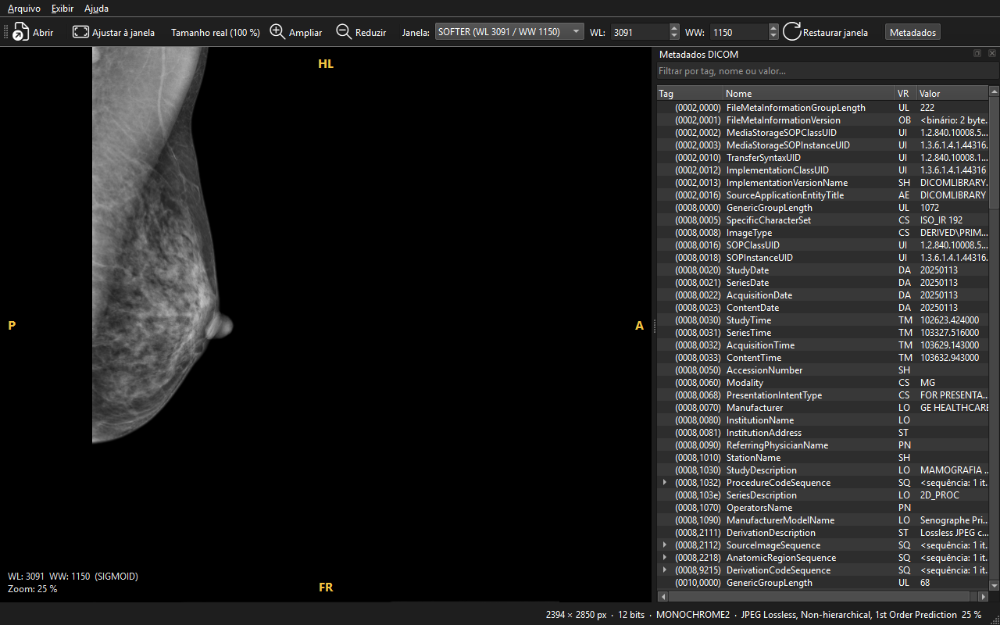
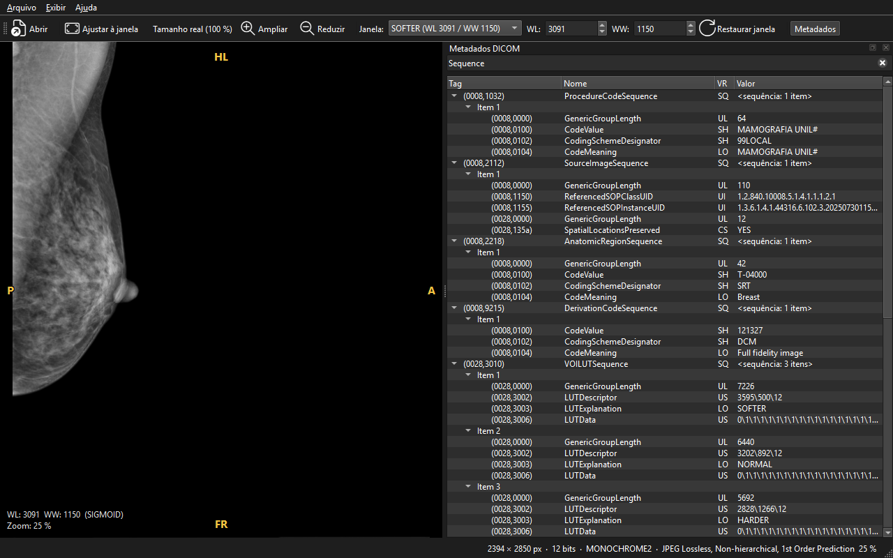
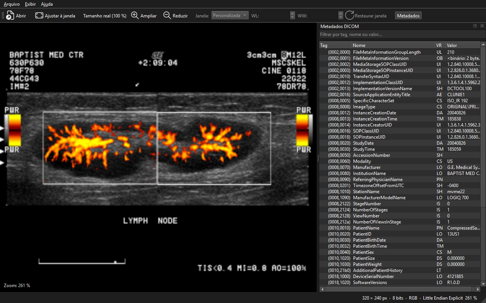
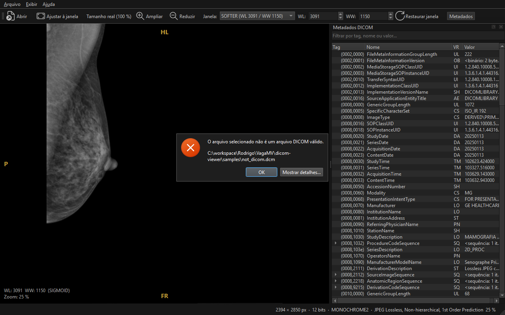

# DICOM Viewer

Visualizador de imagens DICOM para desktop, em **C++23** com **Qt 6 Widgets** e **DCMTK**.

Abre um arquivo DICOM do disco e exibe a imagem com dimensões, escala de cinza e orientação corretas.
Inclui ajuste de janela (Window Level / Window Width), painel de metadados e imagens coloridas.



| Metadados em árvore, com filtro | Imagem colorida |
|---|---|
|  |  |



## Funcionalidades

**Obrigatórias**

- Abrir arquivo pelo diálogo (`Ctrl+O`), por arrastar e soltar ou pela linha de comando.
- Imagens monocromáticas exibidas conforme a norma:
  - `MONOCHROME1` e `MONOCHROME2`, de 8 a 32 bits, com ou sem sinal;
  - Modality LUT / Rescale Slope e Intercept;
  - VOI LUT Function `LINEAR`, `LINEAR_EXACT` e `SIGMOID` (PS3.3 C.11.2.1);
  - Pixel Padding em preto;
  - pixel não quadrado (Pixel Spacing / Pixel Aspect Ratio).
- Orientação: imagem exibida como armazenada (linha 0 no topo, coluna 0 à esquerda), com marcadores do
  paciente (A/P, R/L, H/F) nas bordas, lidos de Patient Orientation ou Image Orientation (Patient).
- Mensagem de erro específica para cada falha. Um erro não fecha a aplicação nem a imagem já aberta.

**Diferenciais**

- **Window Level / Window Width**: arrastar com o mouse, campos numéricos e presets do arquivo.
- **Metadados DICOM** em árvore, com sequências aninhadas, filtro e cópia de linha.
- **Imagens coloridas**: `RGB`, `YBR_FULL`, `YBR_FULL_422` e `PALETTE COLOR`.

**Extras**

- Zoom ancorado no cursor, pan, ajustar à janela e 100 %. Acima de 300 %, os pixels aparecem como blocos
  nítidos, sem interpolação.
- Carregamento em segundo plano: a interface não trava. A mamografia de exemplo (6,8 megapixels,
  JPEG Lossless) abre em cerca de 0,15 s.
- Barra de status com valor do pixel sob o cursor, dimensões, bits, interpretação fotométrica e sintaxe de
  transferência.
- Janela, painel e última pasta lembrados entre execuções.

### Sintaxes de transferência

| Sintaxe | Suporte |
|---|---|
| Implicit VR Little Endian, Explicit VR Little/Big Endian | Sim |
| JPEG Baseline, Extended e Lossless | Sim |
| JPEG-LS Lossless e Near-Lossless | Sim |
| RLE Lossless | Sim |
| Deflated Explicit VR Little Endian | Sim |
| JPEG 2000, HTJ2K, JPEG XL, MPEG, HEVC | Não. O erro informa a sintaxe |

## Bibliotecas

| Biblioteca | Versão | Uso |
|---|---|---|
| [Qt](https://www.qt.io/) | **6.11.3** | Interface (Core, Gui, Widgets, Concurrent) e testes (Test) |
| [DCMTK](https://dicom.offis.de/dcmtk) | 3.7.1 | Leitura, descompressão e Modality LUT (`dcmdata`, `dcmimgle`, `dcmimage`, `dcmjpeg`, `dcmjpls`) |
| [zlib](https://zlib.net/) | via vcpkg | Arquivos Deflated, usada pelo DCMTK |

**Versão do Qt: 6.11.3** (kit `msvc2022_64`). O build aceita a partir da 6.8.

DCMTK e zlib são baixados e compilados pelo [vcpkg](https://vcpkg.io/), com versões fixadas em `vcpkg.json`.

## Requisitos

| Ferramenta | Versão mínima |
|---|---|
| Compilador C++23 | MSVC 19.38 (Visual Studio 2022 17.8), GCC 13 ou Clang 17 |
| CMake | 3.25 |
| Qt | 6.8 |
| vcpkg | recente |
| Git | |

Desenvolvido e testado no **Windows 11 x64**. O preset de Linux está pronto, mas não foi testado.

## Configuração

### Windows

1. Instale o **Visual Studio 2022** com a carga *Desenvolvimento para desktop com C++*.
2. Instale o **Qt 6.11.3** (MSVC 2022 64-bit) pelo [instalador oficial](https://www.qt.io/download-qt-installer-oss).
3. Instale o **vcpkg**:

   ```powershell
   git clone https://github.com/microsoft/vcpkg C:\vcpkg
   C:\vcpkg\bootstrap-vcpkg.bat -disableMetrics
   ```

4. Defina as variáveis usadas pelos presets e abra um novo terminal:

   ```powershell
   setx VCPKG_ROOT "C:\vcpkg"
   setx QT_ROOT_DIR "C:\Qt\6.11.3\msvc2022_64"
   ```

### Linux (Ubuntu 24.04)

```bash
sudo apt install build-essential cmake ninja-build git curl zip unzip tar pkg-config \
                 libgl1-mesa-dev libxkbcommon-dev libfontconfig1-dev libxcb-cursor0
git clone https://github.com/microsoft/vcpkg ~/vcpkg && ~/vcpkg/bootstrap-vcpkg.sh -disableMetrics
export VCPKG_ROOT=~/vcpkg
export QT_ROOT_DIR=~/Qt/6.11.3/gcc_64   # Qt do instalador oficial
```

## Compilação

Na raiz do repositório clonado:

```powershell
cmake --preset windows
cmake --build --preset windows
```

No Linux, use o preset `linux`. A primeira configuração compila o DCMTK e leva alguns minutos.

O Qt Creator e o Visual Studio abrem a pasta diretamente e usam os mesmos presets.

## Execução

```powershell
.\build\windows\src\app\Release\dicom-viewer.exe
.\build\windows\src\app\Release\dicom-viewer.exe samples\anonymized_mamo.dcm
```

No Windows, o build copia as DLLs do Qt e do DCMTK para a pasta do executável.

No Linux: `./build/linux/src/app/dicom-viewer samples/anonymized_mamo.dcm`.

## Testes

```powershell
ctest --preset windows
```

São 15 executáveis Qt Test: núcleo (VOI, LUT, pirâmide, orientação), carregamento de todos os arquivos de
[`samples/`](samples/README.md), inclusive os inválidos, e interface. Os valores de pixel esperados vêm de
uma implementação independente (pydicom).

## Como usar

| Ação | Como |
|---|---|
| Abrir arquivo | `Ctrl+O`, botão **Abrir** ou arrastar o arquivo para a janela |
| Ajustar janela (WL/WW) | Arrastar com o botão esquerdo: horizontal muda a largura, vertical muda o centro |
| Escolher preset | Lista **Janela** |
| Restaurar janela | `R` |
| Zoom | Roda do mouse, `Ctrl++`, `Ctrl+-` |
| Ajustar à janela | `Ctrl+0` ou duplo clique |
| Tamanho real (100 %) | `Ctrl+1` |
| Mover a imagem | Arrastar com o botão do meio, ou `Ctrl` + botão esquerdo |
| Mostrar ou ocultar metadados | `F9` |
| Filtrar metadados | Campo no topo do painel (tag, nome ou valor) |
| Copiar linha de metadados | `Ctrl+C` ou menu de contexto |

Imagens coloridas não têm janelamento: arrastar com o botão esquerdo move a imagem.

## Arquitetura

Três camadas, com dependência em um só sentido:

```
app (Qt Widgets)  ──►  dicom (DCMTK)  ──►  core (C++23 puro)
```

| Camada | Responsabilidade |
|---|---|
| `src/core` | Modelo (`ImageDocument`), VOI, LUT de cinza, pirâmide de resoluções, orientação. Sem Qt e sem DCMTK. |
| `src/dicom` | Único ponto de contato com o DCMTK: lê, descomprime e devolve um `ImageDocument` ou um `LoadError`. |
| `src/app` | Janela principal, viewport, controles de janela, painel de metadados e carga assíncrona. |

Decisões principais:

- **DCMTK isolado.** `dv::loadDicomFile(path)` devolve `std::expected<ImageDocument, LoadError>`. Nenhum tipo
  do DCMTK aparece nos cabeçalhos e nenhuma exceção sai da camada.
- **VOI calculada pela aplicação.** O DCMTK decodifica e aplica a Modality LUT; o resultado fica em um
  buffer de 16 bits. A janela vira uma tabela de até 65 536 entradas, então mudá-la custa uma consulta por
  pixel, sem reler o arquivo.

  ```
  Pixel Data ─► descompressão ─► Modality LUT ─► buffer 16 bits ─► VOI LUT ─► inversão (MONOCHROME1) ─► tela
               └──────────── DCMTK ───────────┘                   └───────────── core ─────────────┘
  ```

- **Pirâmide de resoluções.** A carga gera níveis com metade da resolução (média 2×2). O viewport desenha o
  nível mais próximo do zoom: sem aliasing ao reduzir e com ajuste de janela instantâneo em imagens grandes.
- **Carga fora da thread de interface**, com `QtConcurrent`. Resultados de cargas obsoletas são descartados.
- **Documento imutável**, compartilhado entre as threads como `std::shared_ptr<const ImageDocument>`, sem locks.

```
dicom-viewer/
├── CMakeLists.txt, CMakePresets.json, vcpkg.json
├── cmake/              avisos do compilador e deploy do Qt
├── src/core/           domínio e processamento de imagem
├── src/dicom/          adaptador DCMTK
├── src/app/            interface Qt Widgets
├── tests/              testes de cada camada
├── samples/            arquivos DICOM de exemplo
└── docs/screenshots/   imagens deste README
```

## Tratamento de erros

| Situação | Mensagem |
|---|---|
| Arquivo não existe | "Arquivo não encontrado." |
| Sem permissão de leitura, ou é uma pasta | "Não foi possível ler o arquivo." |
| Não é DICOM, ou está vazio | "O arquivo selecionado não é um arquivo DICOM válido." |
| DICOM sem imagem (laudo estruturado, DICOMDIR) | "O arquivo é DICOM, mas não contém uma imagem." |
| Compressão sem decodificador | "A imagem usa uma compressão não suportada", com o nome da sintaxe |
| Atributos de imagem inválidos | "O formato desta imagem não é suportado." |
| Arquivo truncado ou Pixel Data corrompido | "Os dados da imagem estão corrompidos ou incompletos." |
| Memória insuficiente | "Memória insuficiente para carregar a imagem." |

O botão **Mostrar detalhes** do diálogo traz a mensagem técnica do DCMTK.

## Limitações

- Multi-frame: só o primeiro quadro é exibido. A barra de status informa o total.
- VOI LUT Sequence (0028,3010) não é aplicada; a janela vem de Window Center/Width.
- Overlays (grupo 60xx) e Presentation States não são desenhados.
- Faixa dinâmica acima de 16 bits após a Modality LUT é quantizada para 65 536 níveis.
